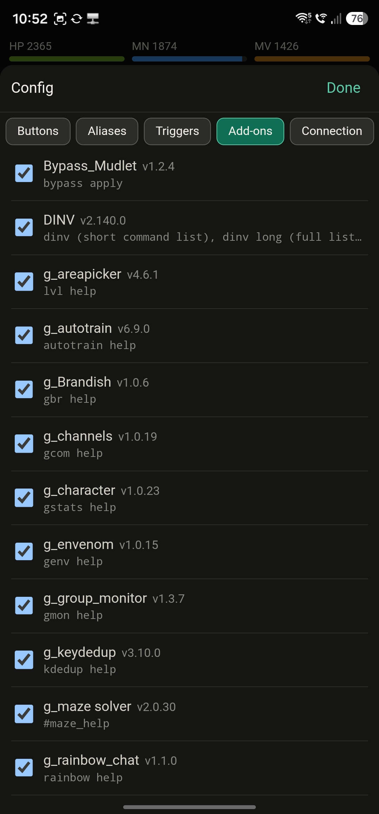
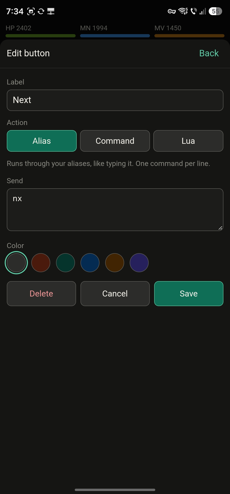

# Aardwolf Mobile

A standalone Android client for [Aardwolf MUD](https://www.aardwolf.com), with the popular
Mudlet add-ons built in and adapted for a phone screen. No Mudlet or MUSHclient needed: install
the app, log in, play.

 

## Features

- **Tabs for everything**: Game, SnD (campaign and quest targets), Chat, Char (stats), Party (group monitor)
- **HP / MN / MV bars** with level, TNL and current room always visible at the top
- **Custom buttons** above the command line: run an alias, a plain command or Lua, in the colour you pick
- **Aliases and triggers** you can make right on the phone
- **Mapper and Search & Destroy databases included**, made for new players; import your own from Mudlet or MUSHclient any time
- **21 add-ons** preinstalled, each one can be switched on or off
- **Add-on updates** from inside the game with `mcheck`, no new APK needed

## Requirements

- Android 8.0 or newer
- An Aardwolf character (or make one at the login screen)

## Install

The app is not on the Play Store, so you install it yourself ("sideloading"). It takes a minute.

1. **Download** [`aardwolf.rar`](../../raw/main/aardwolf.rar) on your phone (or download it on your PC and copy it over).
2. **Extract it.** The download is a RAR archive with `aardwolf.apk` inside; Android cannot install the `.rar` itself.
   - Install a free extractor such as **ZArchiver** or **RAR** (by RARLAB) from the Play Store.
   - Open `aardwolf.rar` in it (usually in your *Download* folder) and extract `aardwolf.apk`.
   - On a PC, 7-Zip or WinRAR work too; then copy `aardwolf.apk` to the phone.
3. **Tap `aardwolf.apk`** to install it.
4. If Android says the app *isn't allowed to install unknown apps*, tap **Settings**, turn on
   **Allow from this source** for the app you opened the APK from, then go back and tap **Install**.
5. If **Google Play Protect** warns about an unknown app, tap **More details → Install anyway**.
   It shows this for every app that doesn't come from the Play Store.
6. Open **Aardwolf** from your app drawer.

### Updating the app

Download and extract the new `aardwolf.rar` the same way and install the APK over the old one.
Your settings, buttons, aliases and databases are kept.

## First run

1. The app connects to `aardmud.org`, port `4000`. You can change this in **⚙ → Connection**.
2. Log in with your character name and password, or create a new character.
3. Type `mcheck` to check for add-on updates.
4. Every add-on has its own help command, listed below. Good places to start: `snd help`, `mapper help` and `dinv`.

  
  

## Settings (⚙)

| Tab | What it does |
|---|---|
| Buttons | Add, edit, colour and reorder the buttons above the command line |
| Aliases | Your own aliases |
| Triggers | Your own triggers |
| Add-ons | Switch each add-on on or off |
| Data | Import your own mapper or S&D database, or switch back to the included one |
| Connection | Host and port |
| Display | Text size and how many lines of output to keep |
| Updates | Check for add-on updates |

## Using your own databases

The app ships with a mapper (`Aardwolf.db`) and Search & Destroy (`SnDdb.db`) database made for
new players: areas up to level 40, Aylor and the continents are fully mapped, and every other
area keeps just the path to its entrance, so speedwalks and campaign runs still work while you
explore the rest yourself.

Already have a full map from Mudlet or MUSHclient? Bring it over:

1. Close Mudlet or MUSHclient on your PC.
2. Put `Aardwolf.db` or `SnDdb.db` (or a zip of your client folder) on Google Drive, OneDrive or the phone.
3. In the app, open **⚙ → Data** and press **Import**. Opening the file with Aardwolf from Files,
   Drive or a chat app works too.
4. No cloud drive? The Data tab can also receive the files from your PC over Wi-Fi.

The included database is kept, and you can switch back at any time.

## Included add-ons

| Add-on | What it does | Help |
|---|---|---|
| **SearchAndDestroy** | Campaign and quest target tracking and hunting (uses mmapper) | `snd help` |
| **mmapper** | Mapper: room database, pathing and speedwalk commands | `mapper help` |
| **DINV** | Inventory manager: tracks, searches and scores your gear; with the identify wish it identifies received items instantly. Needed by several add-ons below | `dinv`, `dinv long` |
| **g_channels** | Chat tab with history, search, timestamps and gags | `gcom help` |
| **g_character** | Char tab: stats, mastery, instinct and resistance reports | `gstats help` |
| **g_group_monitor** | Party tab: group members, invites, filters and health alerts | `gmon help` |
| **g_areapicker** | Lists areas suited to your level, with alignment and offset controls | `lvl help` |
| **g_autotrain** | Weighted stat training by class and subclass, plus saved stat templates from level 200 | `autotrain help` |
| **g_Brandish** | Manages and brandishes charge-safe staves automatically (uses DINV; off until configured) | `gbr help` |
| **g_envenom** | Keeps venom on your weapons and restores your gear safely (uses DINV) | `genv help` |
| **g_keydedup** | Moves duplicate keys to the keyring and destroys extra copies | `kdedup help` |
| **g_maze solver** | Maze exploration helper | `#maze_help` |
| **g_rainbow_chat** | Colour gradients on your tells and channel messages | `rainbow help` |
| **g_RemindMe** | Reminders for level, remort, tier, quest points, trivia points, trains, practices and gold | `remindme help` |
| **g_shinykeep** | Picks up shiny items of chosen tiers and keeps them (uses DINV) | `shinykeep help` |
| **gmobilelayout** | Tidies the login screen for a phone screen | |
| **Hadar_Spellup_Caster** | Spellups, auras, visibility and landing helpers | `had help` |
| **m_enchanter** | Enchanting analyser and helper, including guarded batch enchanting (uses DINV) | `eqa help` |
| **m_Loqui practice** | Picks and practises skills by class, priority, exclusions and limits | `lph help` |
| **msleep** | Sleeps just before a tick when vitals are low, then wakes; optional camp, fire and PK-room handling | `ts help` |
| **Bypass_Mudlet** | Applies your skill bypasses automatically after level changes | `bypass apply` |

Add-on updates come from [Noobgonewild/Mudlet-scripts](https://github.com/Noobgonewild/Mudlet-scripts).
Type `mcheck` in the game to see and install them, and `mcheck help` for more.

## Problems?

- **"App not installed"**: an older build signed differently may be installed. Uninstall it first (this clears its settings), then install again.
- **"There was a problem parsing the package"**: the APK wasn't fully downloaded or extracted. Download and extract again.
- **Can't open the `.rar`**: install ZArchiver or RAR from the Play Store, see step 2.

Bug reports and ideas are welcome in [Issues](../../issues).
